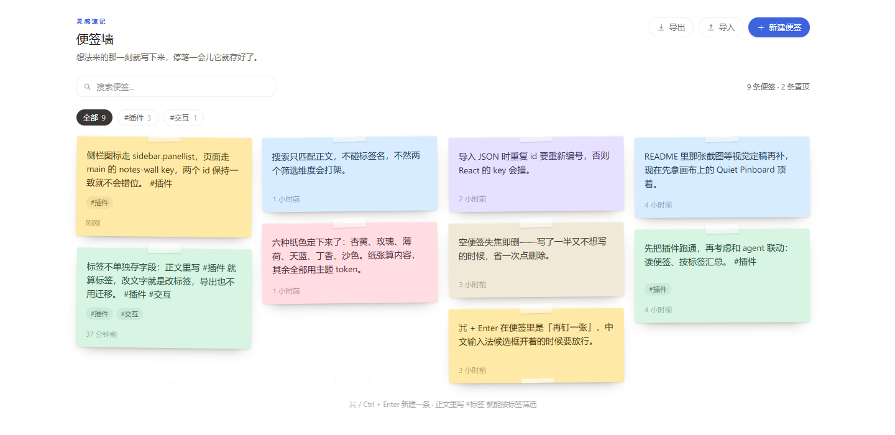
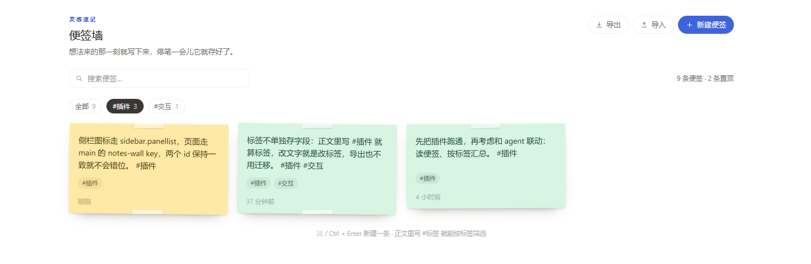

# Notes Wall · 便签墙

A sticky-notes wall pinned to the DSH sidebar: click the icon, capture the thought, keep going.

挂在 DSH 左侧栏的一面便签墙：随手写下想法、灵感和待办，停笔即存。





## What it does / 功能

- **Sidebar entry + full page.** The plugin registers an icon in `sidebar.panellist` (order `12`) and a panel page on the `main` slot under its own `notes-wall` key — it never takes over the conversation panel.
- **Write where you see it.** Every note is a live textarea; text is saved 240 ms after you stop typing.
- **Six paper colors**, a real pin for the ones that matter, and a two-step delete (auto-cancels after 4.5 s).
- **Tags without a tag field.** Type `#插件` inside a note and it becomes a tag. The toolbar grows a filter chip per tag (sorted by usage); clicking a chip or the pill on a note filters the wall. Tags are parsed from the text, so editing the text edits the tag and exported files need no migration.
- **Search** across note bodies, `Esc` clears it.
- **Export / import** as JSON; duplicate ids are renumbered on import.
- **Empty notes clean themselves up** — a note with no text disappears when it loses focus.
- **Local only.** Everything lives in `localStorage` under `dsh.notes-wall.notes.v1`. Nothing is uploaded, nothing enters the session, and the Host half is an empty `apply()`.

便签纸的颜色是「内容」（artwork）；页面、工具栏、按钮、空态全部走宿主主题 token `--dsw-alias-*`，跟随明暗主题。

## Install / 安装

The package ships a `dsh.bundle` manifest, so it is installable like any DSH plugin:

1. Plugin Manager — install from this folder (or from the GitHub repo once published).
2. Or, from a checkout: `dsh plugin add <path-or-git-url>`.

After the first install (and after every edit to `client.js`), **restart DSH** so the new JS generation is loaded; then refresh the page and the notebook icon appears in the sidebar.

## Keyboard / 键盘

| Keys | Action |
| --- | --- |
| `⌘ / Ctrl + Enter` | Pin a new blank note (also available from the toolbar) |
| `Esc` | Close the color palette, or blur the note (an empty note is then dropped) |

## Structure / 结构

```
package.json      dsh.bundle.patch + dsh.client(web, immediately)
cordis.patch.yml  insert: id notes-wall
index.js          Host half — empty apply(), data lives in the browser
client.js         ModuleLoader factory: locale dictionaries, CSS, NoteCard, page, slot registrations
locale/zh.json    meta.title / meta.description (shown by the plugin manager)
locale/en.json
icon.svg          Original notes artwork, 64×64
icon-180.png      Storefront tile, 180×180
screenshots.json  Storefront screenshots (1–8 image paths)
screenshot-1.png  The wall itself
screenshot-2.png  Filtered by #插件
```

## Development notes / 开发注意

- The client half is plain JS wrapped in `window.__ModuleLoader__.load({ id, factory(require) {...} })` — **no JSX**, build elements with `React.createElement` (aliased to `h`).
- Only host modules such as `require('react')` are available. Do **not** require `@deepseek-ai/dsh-client-ui-primitives` or any other Harness Client package; every icon here is hand-drawn SVG.
- All visible text goes through `ctx.locale.register` / `bind`, and the zh/en dictionaries must keep exactly the same keys.
- Styles are injected via `ctx.effect` into `<style data-dsh-notes-wall>` and removed in the cleanup; class names are prefixed `.nw-`.
- Offline self-test: `node ../../.dsh-asar/notes-wall-stub.cjs` — it renders the real component tree on a miniature React, and asserts registration, rendering, edit persistence, tag filtering and pill clicks, empty-note disposal, and locale key parity.

## License

MIT — see [LICENSE](./LICENSE).
